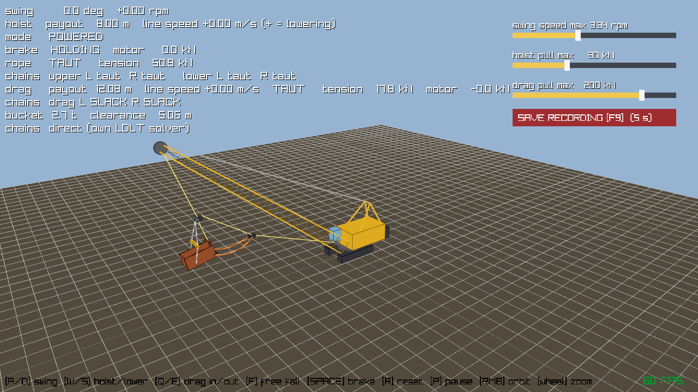

# customDragline

Small test bed for the rigging physics of the Liebherr HS 825 dragline: hoist rope, yoke,
spreader, hoist chains, bucket, drag chains, drag socket and dump rope. The machine itself is
simple boxes; the point is to get the bucket and chains behaving right before the code goes
into the main sim.

PhysX 4.1.2 (TGS) runs the bucket and the ground contact. The chains, yoke, spreader and ropes
run in our own solver (`src/RigSolver.*`, Eigen, sparse LDLT). Rendering is raylib.



## Building

Windows, x64, MSVC, CMake 3.24+.

PhysX is not in the repo. Put the PhysX 4.1.2 SDK in `PhysX-4.1.2/` (it needs the prebuilt
`physx/bin/win.x86_64.vc142.md` libraries). raylib and Eigen are fetched by CMake.

```
cmake -S . -B build -A x64
cmake --build build --config Release
```

## Running

```
build\Release\customDragline.exe          # default (direct solver)
build\Release\customDragline.exe max      # PhysX joints for the chains
build\Release\customDragline.exe art      # PhysX articulation for the chains
```

Only the direct solver has the drag and dump side. The other two are kept for comparison.

| Key | |
|---|---|
| A / D | swing |
| W / S | hoist / lower |
| Q / E | drag in / out |
| F | free fall (clutch out) |
| Space | brake in free fall |
| R | reset |
| P | pause |
| Right mouse, wheel | orbit, zoom |
| F9 | save the input recording since the last reset |

The sliders on the right change the max hoist pull, drag pull and swing speed while it runs.

## Selftest

`dragline_selftest.exe` runs the sim without a window and prints the state every 0.5 s,
then a short summary (max body speed, penetration, sway, joint gap).

```
build\Release\dragline_selftest.exe                  # default run
build\Release\dragline_selftest.exe dump             # also: lower, hang, ground, drag, carry
build\Release\dragline_selftest.exe replay rec.txt   # replay a recording saved with F9
```

## Where to look

- `src/DraglineConfig.h`: all dimensions, masses, damping and solver settings
- `src/Dragline.cpp`: scene setup and the three chain models
- `src/RigSolver.cpp`: the direct solver
- `src/HoistDrum.h`: winch model (used for hoist and drag)
- `HANDOFF.md`: current state and open problems
- `chain_stability_findings.md`, `dragline_chain_solver_spec.md`: background
